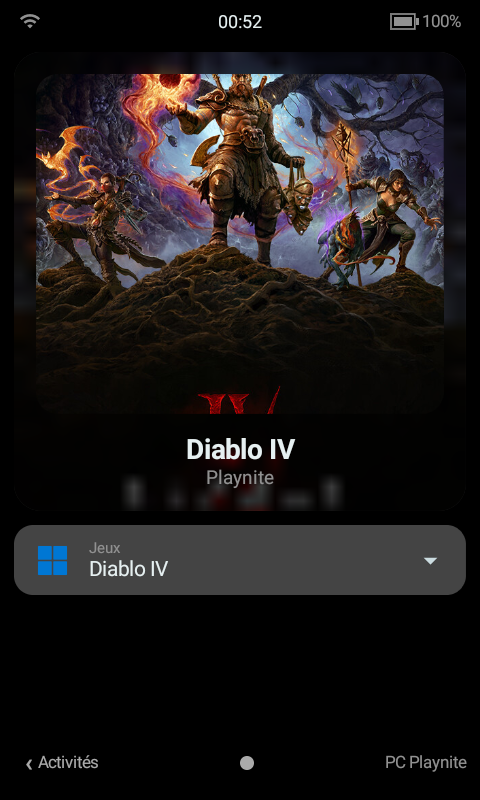
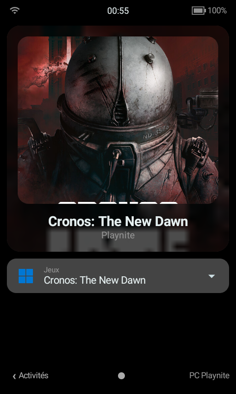

# Astrion Custom Dashboard for Playnite

A [Playnite](https://playnite.link) extension that lets the [Astrion Custom Dashboard](https://github.com/dckiller51/astrion-custom-dashboard)
remote see and drive your gaming PC, with no Home Assistant:

- the game running, with its cover
- your installed games, started from the remote
- turning the PC on (Wake-on-LAN, from the remote) and off

  
  &nbsp;
  

The game running, with its cover, and your games in a list: pick one, it starts on the PC.

## Install

1. Download `AstrionCustomDashboard.pext` from the [releases](../../releases) and open it: Playnite asks to install the extension. Restart Playnite.
2. Playnite shows a notification with a **6-digit code**. In desktop mode it's also in *Extensions › Astrion Custom Dashboard › Show the code
   for the remote*; it's in the log too, and in the file `code.txt` of the extension's data folder.
3. Let the remote reach the PC: the first time, Windows asks whether Playnite can use the network: allow **private networks**
   (Playnite's desktop and fullscreen modes are two programs, each may ask). Or, once, in an administrator command prompt:
   `netsh advfirewall firewall add rule name="Astrion Custom Dashboard Playnite" dir=in action=allow protocol=TCP localport=8095 profile=private`
4. On the remote's web page: *Devices › Direct devices › Players › + Add a PC (Playnite)*: the PC's IP address and the code.

## What it opens

A small HTTP server on port **8095** of the PC, for the remote on your local network:

| | |
|---|---|
| `GET /info` | the PC's name and MAC address (for Wake-on-LAN) |
| `GET /state` | the game running |
| `GET /games` | the installed games, not hidden, most recently played first |
| `GET /cover/<id>` | a game's cover |
| `POST /start/<id>` | starts a game |
| `POST /power/sleep`, `shutdown`, `restart` | the PC |

Every call but `/info` and the covers needs the code (header `X-Astrion-Code`). The code is kept in
Playnite's extension data folder (`code.txt`); delete that file and restart Playnite for a new one.

## Logs

Playnite's own extension log: `%AppData%\Playnite\extensions.log` (installed version) or
`extensions.log` next to `Playnite.DesktopApp.exe` (portable). The lines start with `Astrion Custom Dashboard:`.

## License

---

## ☕ Support

If **Astrion Custom Dashboard** is useful to you, you can buy me a coffee!

